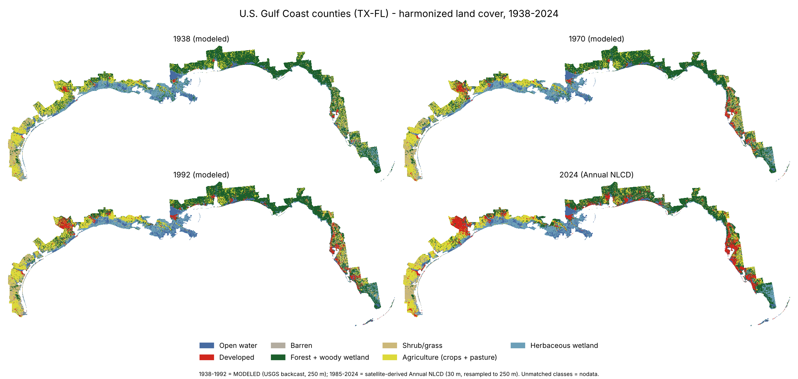
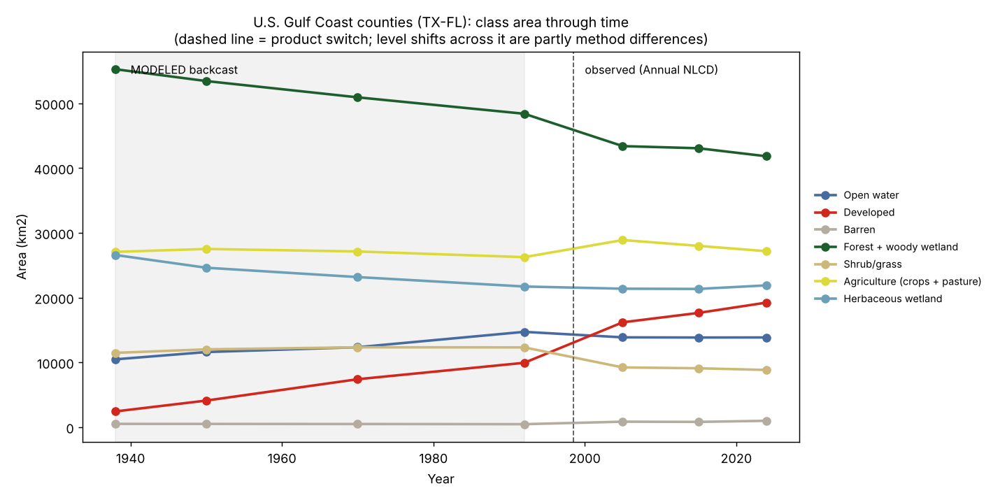
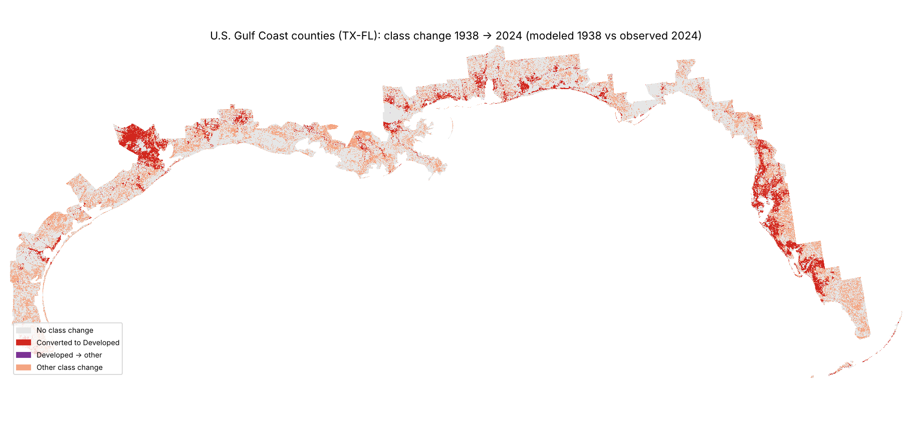
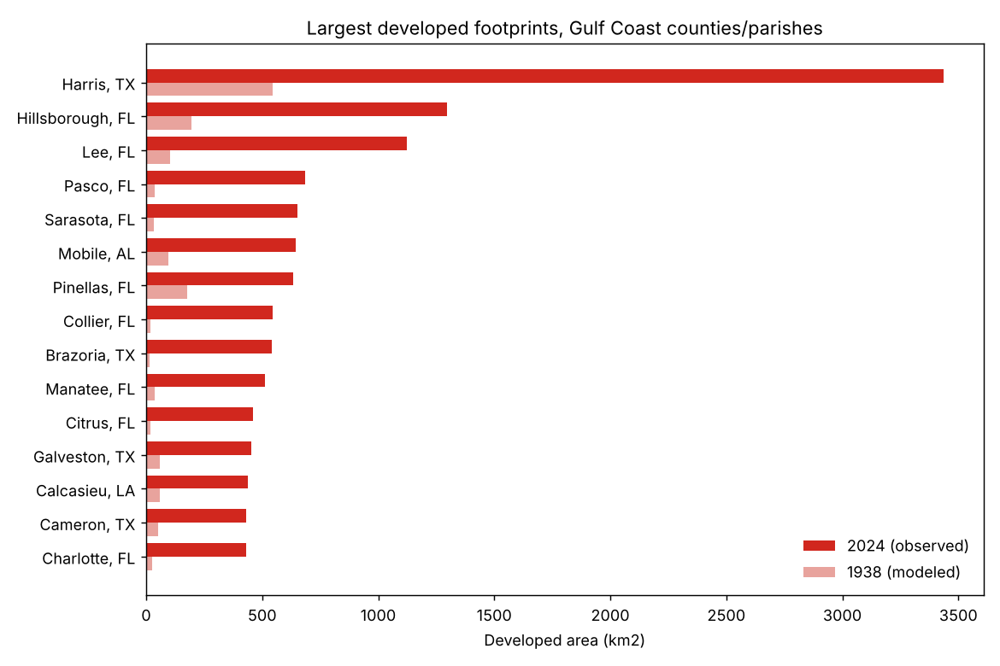
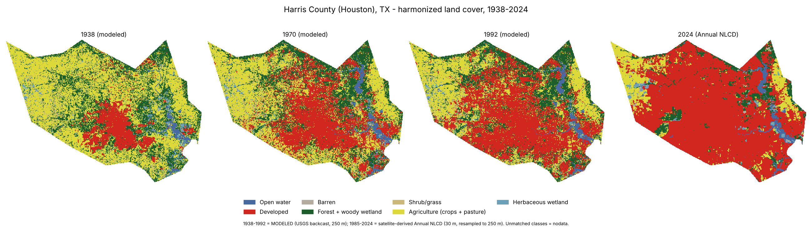

# Land use / land cover change, U.S. Gulf Coast and Houston, 1938 - 2024

Maps and tables built only from public data and open-source Python (rasterio, geopandas, numpy, pandas, matplotlib).
Two study areas share one method: **Harris County, TX (Houston)** and **57 Gulf-facing counties/parishes, TX to FL**.



## Read this first: what 1938-1992 actually is

No satellite land cover map exists for the U.S. before the 1970s. The 1938-1992 layers are a **USGS modeled
backcast** (FORE-SCE), reconstructed backwards from a modified 1992 NLCD using the Census of Agriculture, housing
density and other sources. 1985-2024 is Annual NLCD (Landsat-derived). The products differ in method as well as
resolution, so any change across the 1992 -> 2005 switch mixes real change with product differences.

I measured the difference in the one place both products exist, 1985 (`outputs/*/overlap_1985_*.csv`):

| | Overall agreement, 1985 (coarse classes) | Developed area, backcast vs NLCD |
|---|---:|---:|
| Harris County | 72.3 % (64.2 % detailed) | 1,858 vs 2,324 km2 (-20 %) |
| Gulf Coast (57 counties) | 71.7 % (60.2 % detailed) | 9,441 vs 12,808 km2 (-26 %) |

The backcast under-counts developed land relative to NLCD (mostly exurban/low-density development it maps as
agriculture or forest) and the NLCD maps far more woody wetland and less shrub/grass. So: **trends inside one product
(1938-1992, or 2005-2024) are the most reliable; absolute 1938 -> 2024 change is overstated by roughly the 1985 gap.**
Of the Gulf region's ~16,800 km2 developed-area gain, about 3,400 km2 (~20 %) is the size of that product offset.
Per-county agreement ranges from 49 % (Refugio, TX) to 90 % (Franklin, FL); see `overlap_1985_by_county.csv`.

## Data

| Role | Dataset | Resolution | Source |
|---|---|---|---|
| 1938-1992 | USGS Modeled Historical LULC, CONUS (Sohl et al. 2018) | 250 m, EPSG:5070 | [ScienceBase](https://www.sciencebase.gov/catalog/item/59d3c73de4b05fe04cc3d1d1), DOI 10.5066/F7KK99RR |
| 1985-2024 | Annual NLCD Collection 1.1 Land Cover | 30 m, Albers | [MRLC](https://www.mrlc.gov/data), DOI 10.5066/P94UXNTS |
| Boundaries | County polygons (Census cartographic boundaries as redistributed in [plotly/datasets](https://github.com/plotly/datasets)) | vector | Census Bureau |

Years used: backcast 1938, 1950, 1970, 1985, 1992; NLCD 1985, 2005, 2015, 2024 (2024 is the latest in Collection 1.1
at time of writing). Both land cover products are U.S. Government works with no use restrictions.

## Method

1. Region = list of county FIPS codes (`src/regions.py`), clipped on the 250 m backcast grid (EPSG:5070 equal-area, 0.0625 km2/cell).
2. Class crosswalk to classes present in **both** products; unmatched classes (backcast *Mining*, *Ice*) and cells
   outside the polygons = nodata. Tables use only cells valid in every timeline layer (99.7 % of the Gulf region).
3. NLCD 30 m -> 250 m by **majority (mode)** resampling, in strips to bound memory. Mode erases small patches.
4. **Coarse scheme** (primary): forest + woody wetland, shrub + grass, crops + pasture merged, because the 1985
   comparison shows those pairs are where the products disagree most. Detailed-class tables are also provided.

## Results

### Gulf Coast (km2, coarse scheme; * = modeled backcast)

| Class | 1938* | 1950* | 1970* | 1992* | 2005 | 2015 | 2024 |
|---|---:|---:|---:|---:|---:|---:|---:|
| Open water | 10,477 | 11,600 | 12,350 | 14,721 | 13,872 | 13,847 | 13,857 |
| Developed | 2,434 | 4,110 | 7,407 | 9,942 | 16,195 | 17,642 | 19,238 |
| Barren | 513 | 507 | 491 | 466 | 851 | 817 | 989 |
| Forest + woody wetland | 55,268 | 53,442 | 50,928 | 48,393 | 43,397 | 43,068 | 41,828 |
| Shrub/grass | 11,474 | 12,019 | 12,337 | 12,321 | 9,228 | 9,098 | 8,837 |
| Agriculture (crops + pasture) | 27,066 | 27,518 | 27,129 | 26,254 | 28,893 | 27,997 | 27,172 |
| Herbaceous wetland | 26,586 | 24,621 | 23,177 | 21,721 | 21,382 | 21,349 | 21,896 |

Developed area by state (km2): TX 987 -> 6,533; FL 886 -> 8,795; LA 384 -> 2,102; AL 108 -> 1,068; MS 70 -> 739
(1938 modeled -> 2024 observed; `developed_by_state_km2.csv`). Largest developed footprints in 2024: Harris TX
(3,436), Hillsborough FL (1,297), Lee FL (1,125), Pasco FL (685), Sarasota FL (653), Mobile AL (643).





What the data supports: developed area rose several-fold (about 7.9x 1938 -> 2024 raw; about 1.9x over 1992 -> 2024 across the product switch, and 2005 -> 2024 within NLCD alone it rose from 16,195 to 19,238 km2, +19 %), with the steepest growth in FL and TX counties; forest + woody wetland and herbaceous wetland decline (about -24 % and -18 % 1938 -> 2024 raw). What it does not
support: the exact size of 1938 -> 2024 conversions, the open-water increase (bay/reservoir definition differences
between products), and shrub/grass trends (mode resampling and NLCD's narrow shrub/grass definition).

### Houston (Harris County)

Developed: 546 km2 (1938*) -> 1,958 (1992*) -> 3,436 (2024). Agriculture: 2,460 -> 555. Tables and maps are in
`outputs/houston/`. A Harris-only run uses the same code (`python src/analyze.py houston <raw>`).



## Reproduce

```
pip install -r requirements.txt
python src/fetch_data.py data/raw       # ~6 GB download for the four NLCD years
python src/analyze.py gulf data/raw     # or: houston
python src/figures.py gulf
```

## Limitations / not verified

- **The Gulf county list is hand-assembled** from geography (`src/regions.py`), not an official NOAA list, and omits
  inland coastal-watershed counties. Cartographic county polygons include some bay/near-shore water. Review before citing.
- No independent ground truth was used. The 1985 comparison measures agreement between two products, not accuracy.
- Only four NLCD years are used (not the full annual series), so short-term variability is not shown.
- Mode resampling and class merging are analytic choices; results change if they change.
- Not tested beyond the runs above; there is no automated test suite or CI yet.
